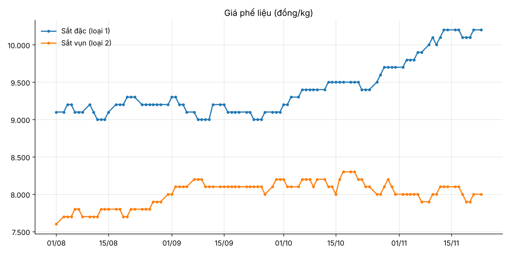

# scrap-price-tracker

[](https://github.com/ferbdev-byte/scrap-price-tracker/actions/workflows/ci.yml)


Ghi và theo dõi **giá thu mua phế liệu** (sắt, đồng, nhôm, inox, chì, giấy, nhựa) theo ngày và theo nguồn báo giá. Công cụ cho thấy giá đang lên hay xuống so với 7 và 30 ngày trước, và vẽ biểu đồ để chốt giá mua bán. Viết cho nghề thu mua phế liệu, nơi giá có thể đổi theo từng ngày.



<sub>Biểu đồ và bảng dưới đây dùng **dữ liệu mẫu** trong [examples/gia-mau.csv](examples/gia-mau.csv). Đây không phải giá thị trường thật.</sub>

```
$ scrapprice board
Loại                    Giá (đ/kg)        Ngày    7 ngày   30 ngày       Thấp–Cao 90 ngày
Đồng cáp                   175.100 23/11/2026    ▲ 0.7%    ▼ 1.6%      172.900 – 183.900
Inox 304                    30.800 23/11/2026    ▼ 1.3%    ▼ 3.1%        30.800 – 33.000
Nhôm đặc                    50.100 23/11/2026    ▲ 3.1%    ▲ 5.9%        45.800 – 50.100
Sắt đặc (loại 1)            10.200 23/11/2026    = 0.0%    ▲ 8.5%         9.000 – 10.200
Sắt vụn (loại 2)             8.000 23/11/2026    ▼ 1.2%    ▼ 1.2%          7.800 – 8.300
```

## Tính năng

- **Hiểu cách gọi tên tự do**: `"Sắt loại 1"`, `"sat L1"`, `"sắt đặc"` đều được nhận là cùng một loại. Có danh mục 14 loại phổ biến.
- **Hiểu cách viết giá kiểu Việt Nam**: `12.500`, `12,500`, `12500đ`, `12.5k`, `185k`.
- **Nhiều nguồn báo giá** (vựa, nhà máy, đối tác): mỗi nguồn lưu riêng; một ngày có nhiều nguồn thì lấy trung bình.
- **Thống kê**: giá mới nhất, % thay đổi 7/30 ngày, giá thấp/cao/trung bình 90 ngày.
- **Nhập CSV hàng loạt**: báo cáo từng dòng lỗi, không bỏ dở cả file.
- **Biểu đồ PNG** để gửi nhóm Zalo hoặc đưa vào báo cáo.
- Chỉ dùng một file SQLite, không cần cài máy chủ cơ sở dữ liệu.

## Cài đặt

```powershell
pip install "scrap-price-tracker[chart] @ git+https://github.com/ferbdev-byte/scrap-price-tracker"
```

## Dùng

```powershell
scrapprice types                                  # danh mục loại phế liệu
scrapprice add "sắt loại 1" 9.500 --nguon "vựa A" # thêm giá hôm nay
scrapprice add dong-cap 182k --ngay 2026-11-20
scrapprice import examples/gia-mau.csv            # nhập hàng loạt
scrapprice board                                  # bảng giá hiện tại
scrapprice history "đồng cáp" --days 30
scrapprice chart sat-dac sat-vun -o sat.png       # vẽ biểu đồ
scrapprice export -o gia.csv --days 90            # xuất CSV (mở bằng Excel, nhập lại được)
```

Định dạng CSV:

```csv
ngay,loai,gia,nguon,ghi_chu
2026-11-01,Sắt loại 1,9.200,vựa A,
2026-11-01,Đồng cáp,182k,nhà máy B,giao tận nơi
```

## Dùng như thư viện

```python
from datetime import date
from scrapprice import PriceDB, Quote, normalize

db = PriceDB("gia.db")
db.add(Quote(date.today(), normalize("nhôm lon"), 32000, "vựa A"))
s = db.stats("nhom-lon")
print(s.latest, s.change_7d)
```

## Phát triển

```powershell
pip install -e ".[dev]"
ruff check .
pytest
```

## Giấy phép

MIT
